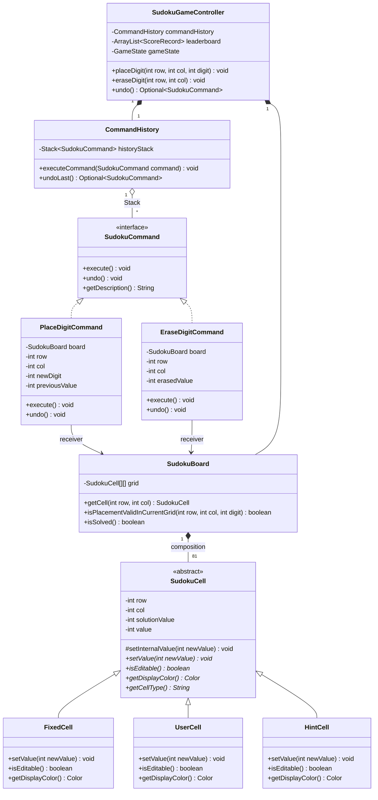

# SudokuMaster — Java OOP Projectwork Assignment (Prog 2)

**SudokuMaster** is a complete, production-ready Java application implementing a full-featured 9×9 Sudoku puzzle game with both a modern **Java Swing Desktop GUI** (inspired by mobile Sudoku apps) and an **Interactive Console CLI** fallback mode.

---

## 1. Problem Statement

- **Target Users:** Logic puzzle players, students, and casual desktop gamers who enjoy solving 9×9 Sudoku puzzles across varying difficulty tiers (`EASY`, `MEDIUM`, `HARD`).
- **User Goal:** Solve 9×9 Sudoku puzzles efficiently with visual peer highlighting, immediate rule validation, mistake tracking (`Mistakes: 0/3`), hints, multi-step Undo capability, and persistent progress/leaderboards.
- **Problem Solved:** Static paper or basic grid implementations allow players to accidentally overwrite initial puzzle clues, fail to detect row/column/3×3 subgrid rule conflicts until much later, lose their progress when closing the window, and lack multi-step undo when exploring candidate placements. **SudokuMaster** solves these problems through strict object-oriented domain modeling, polymorphic cell types, the **GoF Command Pattern** for multi-level Undo, custom domain exception handling, and JSON file persistence.

---

## 2. Prerequisites

- **Java Development Kit (JDK):** Java 17 or newer (compatible with Java 17, 21, and latest LTS releases)
- **Build Tool:** Apache Maven 3.8+

---

## 3. Build, Run & Test Instructions

### A. Run Directly in IntelliJ IDEA (Green Run Button)
This repository includes pre-configured IntelliJ IDEA run configurations under `.idea/runConfigurations/`:
1. Open the `SudokuMaster` project folder in **IntelliJ IDEA**.
2. Select **`SudokuMaster (GUI)`** (or **`SudokuMaster (Console CLI)`**) in the top-right run configuration dropdown.
3. Click the green **Run (▶)** button.

### B. Build & Run via Maven (Command Line)

```bash
# 1. Clean compile and run the full JUnit 5 test suite
mvn clean test

# 2. Package into an executable JAR
mvn clean package

# 3. Launch the primary Desktop Swing GUI (default mode)
mvn exec:java
# OR via the packaged JAR:
java -jar target/sudoku-master-1.0.0.jar

# 4. Launch the Interactive Console CLI mode
mvn exec:java -Dexec.args="--cli"
# OR via the packaged JAR:
java -jar target/sudoku-master-1.0.0.jar --cli
```

---

## 4. Sample Usage

### Desktop Swing GUI Mode
- **Cell Selection:** Click any cell on the 9×9 grid or navigate using Arrow keys / `W` `A` `S` `D`. The selected cell, its row/column/3×3 box peers, and matching digits across the board are dynamically highlighted.
- **Placing Digits:** Click a bottom numeric keypad button (`1`–`9`) or press `1`–`9` on your keyboard.
- **Undo (Geri Al):** Click **`↶ Undo (Geri Al)`** (or press `U` / `Ctrl+Z`) to pop and reverse the most recent move from the `Stack<SudokuCommand>`.
- **Erase:** Click **`⌫ Erase`** (or press `Backspace` / `Delete`) to clear an editable `UserCell`.
- **Hint:** Click **`💡 Hint`** (or press `H`) to convert the selected cell into a locked emerald-green `HintCell`.
- **Save / Load / Leaderboard:** Use the top header buttons to save unfinished puzzle progress (`data/saved_game.json`), restore a saved session, or open the sortable High Scores Leaderboard (`data/highscores.json`).

### Interactive Console CLI Mode (`--cli`)
```text
============================================================
          SUDOKU MASTER — Interactive Console Mode          
============================================================
Commands:
  place <row> <col> <digit>  (or: p r c d)   Place digit 1-9 at row (1-9), col (1-9)
  erase <row> <col>          (or: e r c)     Clear user digit at row (1-9), col (1-9)
  undo                       (or: u)         Undo the last move (Command Pattern Stack)
  hint [row] [col]           (or: h)         Reveal a HintCell on the board
  new [EASY|MEDIUM|HARD]     (or: n)         Start a new game
  save                                       Save current game progress to JSON
  load                                       Load saved game progress from JSON
  scores [score|diff|date]                   View sorted high scores leaderboard
  quit                       (or: q)         Exit SudokuMaster

[SudokuMaster]> place 1 3 4
[OK] Placed 4 at (1, 3).

[SudokuMaster]> undo
[UNDO] Reverted: Place 4 at (1, 3)
```

---

## 5. Implemented Technical Requirements

| Requirement Area | Implementation Evidence in `SudokuMaster` |
| :--- | :--- |
| **Encapsulation** | All domain, command, service, and persistence classes use `private` fields (`final` where immutable), defensive constructor validation (rejecting invalid coordinates, negative scores/timers, or out-of-range digits), and controlled getter/setter methods. No public mutable fields exist. |
| **Abstraction** | `SudokuCell` (`abstract class`) defines the polymorphic contract for grid cells (`setValue()`, `isEditable()`, `getDisplayColor()`, `getCellType()`, `copy()`). `SudokuCommand` (`interface`) defines the contract for reversible user actions (`execute()`, `undo()`, `getDescription()`). |
| **Inheritance & Polymorphism** | `FixedCell`, `UserCell`, and `HintCell` extend `SudokuCell`. At runtime, `SudokuBoard`, `PlaceDigitCommand`, `EraseDigitCommand`, and `SudokuGridPanel` invoke `cell.isEditable()`, `cell.setValue()`, and `cell.getDisplayColor()` polymorphically on `SudokuCell[][]` references without type-casting. |
| **Relationships & Multiplicities** | **Composition:** `1 SudokuBoard` owns `81 SudokuCell` instances (`SudokuCell[9][9]`); `1 GameState` owns `1 SudokuBoard`; `1 SudokuGameController` owns `1 CommandHistory` and `1 GameState`. **Aggregation:** `1 CommandHistory` aggregates `* SudokuCommand` instances in a `Stack<SudokuCommand>`; `1 SudokuGameController` aggregates `* ScoreRecord` objects in an `ArrayList<ScoreRecord>`. |
| **Collections, Generics & Sorting** | Leaderboard entries are stored in `ArrayList<ScoreRecord>`. `ScoreRecord` implements `Comparable<ScoreRecord>` (natural order: highest score descending, then fastest completion time ascending) and provides secondary `Comparator<ScoreRecord>` instances (`BY_DIFFICULTY_AND_TIME`, `BY_DATE_DESCENDING`, `BY_FASTEST_TIME`). |
| **Custom Domain Exception** | `InvalidSudokuMoveException` is thrown when attempting to overwrite a `FixedCell` or `HintCell`, placing a conflicting digit in the same row/column/3×3 box, erasing an empty cell, or making a move after reaching `3/3` mistake strikes. Both GUI and CLI catch and present friendly feedback. |
| **Persistence** | `GamePersistenceManager` reads and writes both high scores (`data/highscores.json`) and unfinished game sessions (`data/saved_game.json` with board cells, timer, mistakes, difficulty, and score) using `try-with-resources` (`BufferedReader` / `BufferedWriter`). |
| **Unit Testing** | JUnit 5 test suites (`SudokuRulesTest` and `CommandHistoryTest`) verify polymorphism, board validation rules, strike limits, sorting, JSON persistence, and multi-level Command undo. |

---

## 6. UML Class Diagram

See [docs/UML_Class_Diagram.md](docs/UML_Class_Diagram.md) and the PlantUML source [docs/uml_diagram.puml](docs/uml_diagram.puml).



---

## 7. Design Pattern Explanation: GoF Command Pattern

### Pattern Name
**Command Pattern** (Behavioral Design Pattern — Gang of Four).

### Participating Classes
1. **`SudokuCommand` (Command Interface — `com.sudokumaster.command.SudokuCommand`):** Declares the execution contract `execute() throws InvalidSudokuMoveException`, state reversal contract `undo()`, and `getDescription()`.
2. **`PlaceDigitCommand` (Concrete Command — `com.sudokumaster.command.PlaceDigitCommand`):** Encapsulates placing a digit (`1..9`) at `(row, col)` on the `SudokuBoard`. Before mutating the target `SudokuCell`, it validates board rules and captures `previousValue` so `undo()` restores the exact prior digit.
3. **`EraseDigitCommand` (Concrete Command — `com.sudokumaster.command.EraseDigitCommand`):** Encapsulates clearing a user-entered digit at `(row, col)` back to `0`. It captures `erasedValue` prior to clearing so `undo()` restores the erased digit.
4. **`SudokuBoard` / `SudokuCell` (Receiver — `com.sudokumaster.domain.*`):** The domain objects whose state is mutated and restored by the concrete commands.
5. **`CommandHistory` (Invoker — `com.sudokumaster.command.CommandHistory`):** Maintains a `Stack<SudokuCommand>` (`historyStack`). Only commands whose `execute()` succeeds without throwing `InvalidSudokuMoveException` are pushed onto the stack. Calling `undoLast()` pops the top command in LIFO order and invokes `undo()`.
6. **`SudokuGameController` / `SudokuFrame` / `ConsoleUI` (Clients):** Create concrete command instances and trigger execution/undo via the GUI **"↶ Undo (Geri Al)"** button or the CLI `undo` command.

### Benefits in Our Design
- **Multi-Level Undo Without Snapshot Overhead:** Instead of cloning the entire 81-cell board before every move, each command stores only the coordinates and previous digit of a single cell.
- **UI Decoupling:** Both the Swing GUI (`SudokuFrame`) and the Console CLI (`ConsoleUI`) trigger the exact same `CommandHistory` operations without duplicating board state restoration logic.
- **Transactional Safety:** Because `command.execute()` is invoked before `historyStack.push(command)`, invalid moves that throw `InvalidSudokuMoveException` never pollute the undo history stack.

---

## 8. Main Design Decisions & Known Limitations

### Main Design Decisions
1. **Dual-Mode Architecture (Shared Controller & Domain):** `SudokuGameController` is completely decoupled from `javax.swing` and `System.in`/`System.out`, allowing `SudokuFrame` (GUI) and `ConsoleUI` (CLI) to share 100% of the business rules, command stack, and persistence layer.
2. **Zero External Runtime Dependencies for JSON Persistence:** `GamePersistenceManager` implements clean, human-readable JSON serialization/deserialization using standard Java NIO (`Files.newBufferedWriter` / `Files.newBufferedReader` inside `try-with-resources`), ensuring zero dependency conflicts on any clean checkout.
3. **Polymorphic Cell Rendering:** `SudokuCell.getDisplayColor()` returns distinct `java.awt.Color` values per concrete subclass (`FixedCell` in dark slate, `UserCell` in royal blue or crimson red if conflicting, `HintCell` in emerald green), eliminating `instanceof` checks in the renderer.

### Known Limitations
1. **Undo History Across Saved Sessions:** Saving a game persists all 81 cell types/values, timer, score, difficulty, and mistake count to `data/saved_game.json`, and resets the in-memory `Stack<SudokuCommand>` upon reload.
2. **Single-Player Local Leaderboard:** The leaderboard is stored locally in `data/highscores.json` rather than synchronized with a remote cloud server.

---

## 9. Contributors & License

- **Name:** Bugra Erenay Gul
- **Student ID:** GZW419
- **Course:** Programming 2 (Java OOP Projectwork Assignment)
- **License:** Distributed under the [MIT License](LICENSE).
