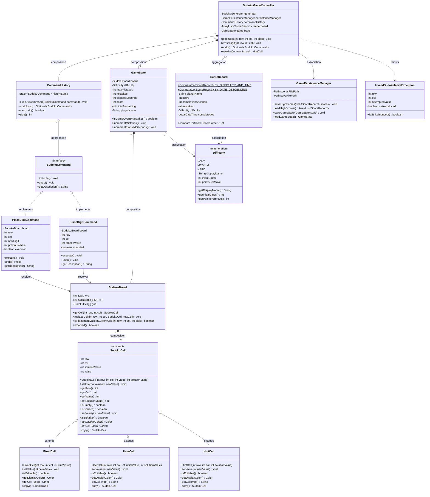

# SudokuMaster — UML Class Diagram & Architecture

This document provides the rendered Mermaid UML Class Diagram (viewable directly in GitHub/GitLab/Markdown viewers) alongside the editable PlantUML source located at [uml_diagram.puml](uml_diagram.puml).

## Mermaid UML Class Diagram

